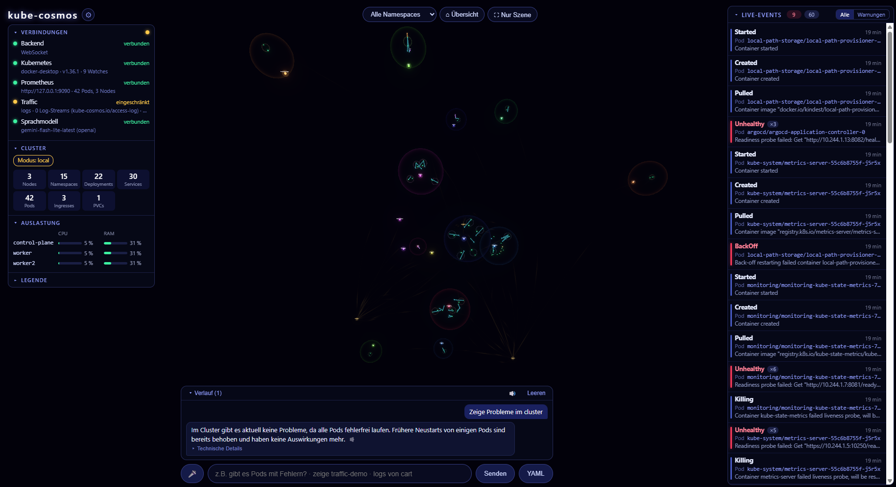

# kube-cosmos

Echtzeit-3D-Visualisierung eines Kubernetes-Clusters: Namespaces sind Galaxien, Pods Sterne, Deployments, Services, Ingresses und PVCs eigene Himmelskörper, Traffic fliegt als Kometen zwischen ihnen. Steuerung per Maus, Text oder Sprache; ein Sprachmodell übersetzt Fragen in `kubectl`-Befehle (lesende laufen sofort, ändernde erst nach Bestätigung).



> Status: frühe Version 0.1.0. Der Modus `production` (Auth, Audit) ist noch nicht implementiert.

**Features:** Live-Abgleich per Watch-API · echter Traffic aus Access-Logs (nginx, Traefik) · optional CPU/RAM aus Prometheus · Probes, HPA, Events, Ingress-Routen · Namespace-Filter, Übersicht, „Nur Szene“-Modus · Kontextmenü mit kubectl-Aktionen · Sprach-/Textsteuerung (Gemini, jede OpenAI-kompatible API oder lokal Ollama).

## Voraussetzungen

- Node.js 23 (oder neuer), `kubectl`
- ein Kubernetes-Cluster in der kubeconfig (getestet mit Docker Desktop; jeder Context über `KUBE_CONTEXT`)
- optional: API-Schlüssel für ein Sprachmodell (`backend/.env`, Vorlage `backend/.env.example`) oder Ollama lokal

## Sicherheit

- `MODE=local` (Default) bindet nur an 127.0.0.1 und kann nach Bestätigung **ändernde Befehle am Cluster ausführen**. Für fremde oder produktive Cluster `MODE=readonly` verwenden.
- Fragen sowie Namespace-, Deployment- und Service-Namen und Befehlsausgaben gehen an das konfigurierte Sprachmodell. Im kostenlosen Gemini-Kontingent darf Google diese Daten zur Produktverbesserung nutzen. Ohne Datenweitergabe: Ollama lokal.
- Secrets werden nie gelesen oder angezeigt (keine Secret-Befehle, kein `-o yaml`).

## Schnellstart

```bash
cd backend
npm install
npm start          # MODE=local (Default), WS auf ws://127.0.0.1:7070
```

```bash
cd frontend
npm install
npm run dev        # http://127.0.0.1:5173 (VITE_WS_URL überschreibt WS-Adresse)
```

Backend-Env: `MODE=local|readonly|production`, `PORT=7070`, `KUBE_CONTEXT=docker-desktop`, `K8S_AUTH=kubeconfig|incluster`, `NAMESPACES=ns1,ns2` (leer = alle), `TRAFFIC_SOURCE=logs|mock|none|hubble` (Default logs), `LOG_SELECTOR=kube-cosmos.io/access-log`, `MAX_FLOWS_PER_SEC=600`, `LLM_*` siehe unten.

## Optional: Prometheus (CPU/RAM je Pod, Node-Last)

Ohne `PROMETHEUS_URL` läuft kube-cosmos wie gehabt. Mit Prometheus (z.B. kube-prometheus-stack):

```bash
kubectl -n monitoring port-forward svc/monitoring-kube-prometheus-prometheus 9090:9090
cd backend && PROMETHEUS_URL=http://127.0.0.1:9090 npm start
```
Heiße Pods (CPU) werden größer und glühen orange, Pods mit RAM > 85 % des Limits pulsieren rot, Node-Last als Balken im HUD.
Env: `PROMETHEUS_URL`, `PROMETHEUS_TOKEN` (optional Bearer), `METRICS_INTERVAL_SEC=10`.

## Echter Traffic (Demo + Lasttest)

```bash
kubectl apply -f demo/traffic-demo.yaml                     # loadgen → Traefik (Ingress shop.local) → shop-frontend → shop-api
# einmalig: Traefik-Access-Logs + Label, damit auch der Hop loadgen → Traefik sichtbar ist (rückgängig: kubectl -n traefik rollout undo deploy/traefik)
kubectl -n traefik patch deploy traefik --type=json -p='[{"op":"add","path":"/spec/template/spec/containers/0/args/-","value":"--accesslog=true"},{"op":"add","path":"/spec/template/metadata/labels/kube-cosmos.io~1access-log","value":"traefik"}]'
cd backend && npm start                                     # liest Access-Logs (Default)
node demo/load-scenario.mjs 300                             # Lastszenario von außen: catalog Welle, cart Bursts, payment-Spitze ab 2:00, api Rampe,
                                                            # recommender CPU-Welle + RAM-Rampe 0:40–2:20 (mit Prometheus: orange/rot)
bash demo/external-load.sh 120 4                            # einfache gleichmäßige Last von außen über localhost:80
kubectl apply -f demo/perf-job.yaml                         # Lasttest (ApacheBench, im Cluster über den Ingress)
kubectl -n traffic-demo logs -f job/perf                    # Ergebnis
kubectl delete namespace traffic-demo                       # aufräumen
```

## Im Cluster installieren

Siehe [INSTALL.md](INSTALL.md) (Image in eigene Registry + `deploy/readonly.yaml`, Zugriff per Port-Forward). Docker Desktop lokal: außerhalb des Clusters betreiben (siehe oben).

## Sprachmodell wechseln (nur Konfiguration)

```bash
# lokal (Standard)
LLM_PROVIDER=ollama LLM_BASE_URL=http://127.0.0.1:11434 LLM_MODEL=qwen2.5-coder:7b npm start
# jede OpenAI-kompatible API (OpenAI, OpenRouter, Groq, Mistral, Gemini, vLLM, LM Studio …)
LLM_PROVIDER=openai LLM_BASE_URL=https://api.openai.com/v1 LLM_API_KEY=… LLM_MODEL=<modell> npm start
```
Weitere: `LLM_TIMEOUT_SEC=120`, `COMMAND_ENGINE=llm|kubectl-ai`. Prompts: `backend/src/prompts.ts`.
Dauerhaft: `backend/.env` (Vorlage `backend/.env.example`, aktuell Gemini `gemini-flash-lite-latest`); wird beim Start automatisch gelesen, ist von Git ausgeschlossen.

## Lizenz

[Apache-2.0](LICENSE)
